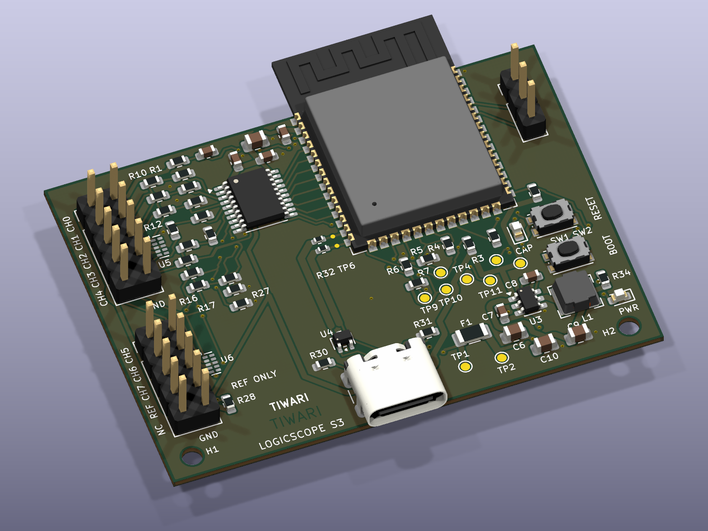
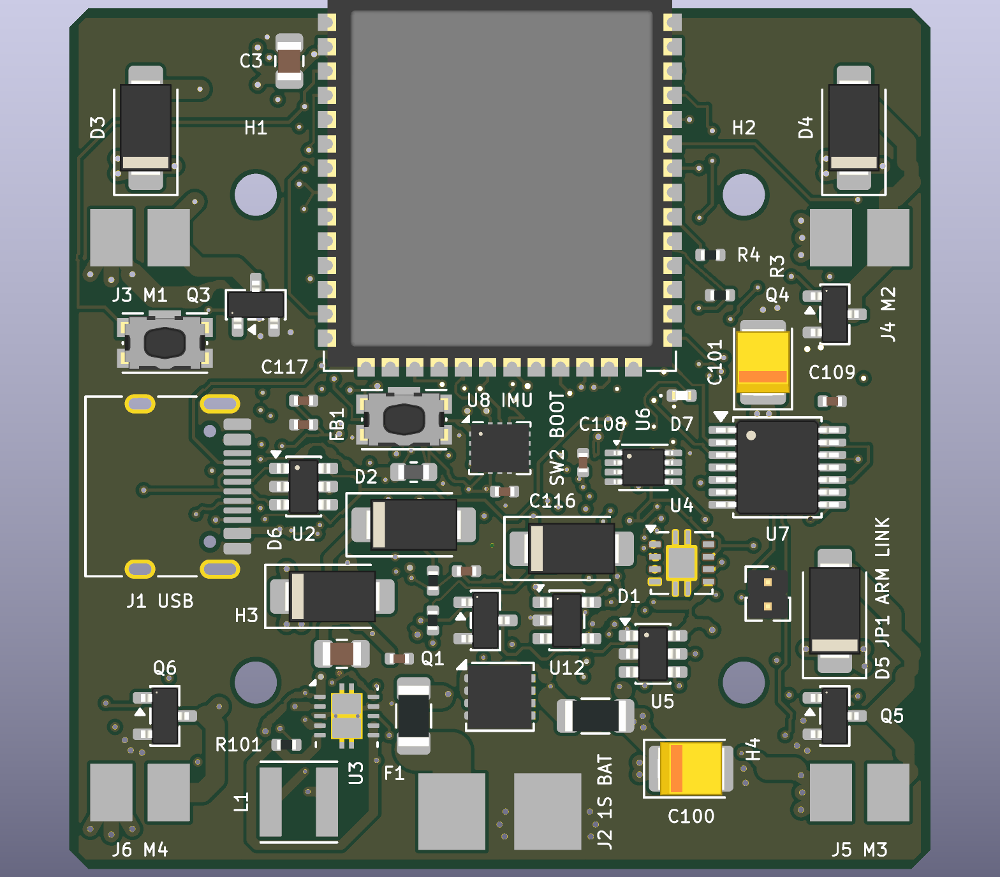
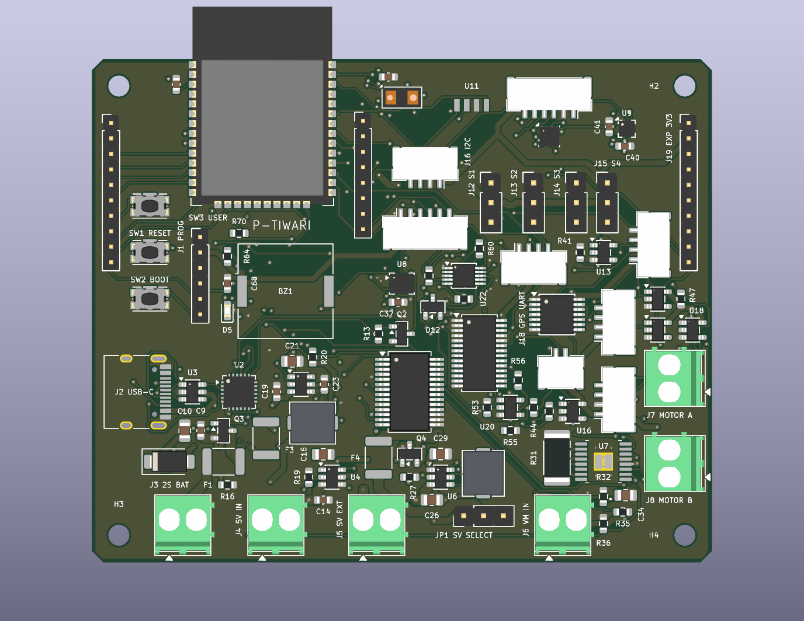

# Open Source PCB

Open hardware designs for ESP32 robotics, a brushed-motor flight controller, and a USB logic analyser.

## LogicScope S3

[LogicScope S3](LogicScope_S3/) is a compact 8-channel USB digital logic analyser hardware prototype built around the ESP32-S3, with a 55 x 40-mm, two-layer PCB.

- [Project documentation](LogicScope_S3/README.md)
- [KiCad project](LogicScope_S3/LogicScope_S3.kicad_pro)
- [Fabrication and assembly package](LogicScope_S3/fabrication/)
- [Engineering report](LogicScope_S3/docs/Engineering_Report.md)
- [Hardware validation plan](LogicScope_S3/docs/Validation_Plan.md)
- [License](LogicScope_S3/LICENSE)

LS-S3-A0 has recorded passing ERC, DRC, connectivity and schematic/PCB parity checks. Firmware and a simple desktop app v0.1.0 are implemented, with finite DMA captures, an eight-channel viewer, timing cursors and CSV/VCD export. Sampling performance and electrical behavior require physical prototype validation.

- [Firmware: build and flash](LogicScope_S3/firmware/README.md)
- [Desktop app: install and demo](LogicScope_S3/software/README.md)
- [Software verification](LogicScope_S3/docs/Software_Verification.md)

## RoveFlight S3

[RoveFlight S3](RoveFlight_S3/) is a 45 x 45-mm, six-layer ESP32-S3 controller for a 1S brushed quadcopter, with hardware motor interlocks, IMU, barometer, ToF and expansion interfaces.

- [Project documentation](RoveFlight_S3/README.md)
- [KiCad project](RoveFlight_S3/RoveFlight_S3.kicad_pro)
- [Fabrication and assembly package](RoveFlight_S3/fabrication/)
- [Manufacturing readiness and validation](RoveFlight_S3/docs/Manufacturing_Readiness.md)
- [License](RoveFlight_S3/LICENSE)

RF-S3-A0 passes ERC, DRC, connectivity and schematic/PCB parity checks. Via filling/capping and fabricator DFM are required; bench and flight qualification remain open.

## RoveCore One

The complete ESP32 robotics PCB project is in [RoveCore](RoveCore/).

- [Project documentation](RoveCore/README.md)
- [KiCad project](RoveCore/RoveCore_One.kicad_pro)
- [Fabrication files](RoveCore/fabrication/)
- [Manufacturing readiness](RoveCore/docs/Manufacturing_Readiness.md)
- [License](RoveCore/LICENSE)

