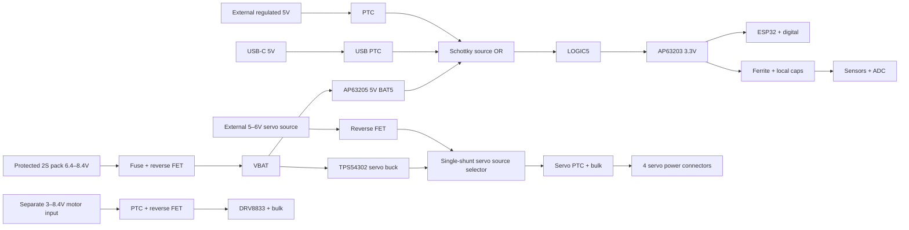

# P-TIWARI power architecture and design calculations

These are design estimates and operating targets, not measured ratings. Rail limits are simultaneous system budgets, not additive entitlements.

All domains have a common ground reference. Dedicated power paths and local returns keep servo and motor currents out of regulator/sensor feed paths; ground is not deliberately split into disconnected islands. In1 is reserved for a continuous ground plane, with ground stitching and power return vias. The final saved PCB and routing audit show how this was implemented.

## Input and rail limits

| Input or rail | Recommended target | Important qualification |
|---|---|---|
| Battery J3 | Protected 2S, 6.4–8.4 V, ≤2 A continuous total at room temperature | Cell cutoff/balance protection in pack is mandatory; PTC is not a precise electronic limiter |
| USB-C | Regulated 5 V; logic only | No USB PD negotiation; do not assume 1.5/3 A based solely on USB-C connector |
| External J4 | Regulated 5 V; logic only | Reverse flow is blocked by diode; ground reference shared |
| Motor J6 | 3–8.4 V; 0.6 A continuous per motor | Separate supply; must absorb braking energy; no active regenerative clamp |
| 3.3 V | 1 A total regulator design target; external expansion ≤150 mA | Under USB-only operation use a lower budget, approximately 500 mA total with an entitled 500 mA USB source |
| BAT5 | Battery-derived 5 V; external accessories ≤300 mA | Also feeds logic through OR diode; total BAT5 target ≤1 A, not the IC's 2 A headline rating |
| Servo rail | 2 A continuous total from suitable source after thermal validation | Under minimum battery voltage + heavily loaded logic, cap servo continuous load at 1.5 A; external source can supply the full target |
| Servo transient | 3 A brief peak, conditional | Not validated; PTC temperature, FET dissipation, inductor peak and rail droop must be measured |
| Load connector | 5 V, 250 mA max | Shares BAT5 accessory budget; motor/relay load must meet diode and supply constraints |

BAT5-powered ultrasonic and servo signal buffers do not operate from USB alone. External servo supply by itself does not establish BAT5. Fit only one JP1 shunt: pins 1–2 select battery-derived servo power, pins 2–3 select external servo power. Remove power before moving the shunt. Never short all three selector pins. Do not connect an external source to a servo output's power pin.

## Battery and charging decision

This PCB has **no 2S charger, balancer or cell-level protection circuit**. Battery input means a protected pack input, not USB charging. Use a pack with overcharge, overdischarge, overcurrent/short-circuit protection and cell balancing, and an external appropriate 8.4 V CC/CV balance charger. Disconnect the pack for charging. A one-cell linear charger is unsuitable for 2S and is intentionally absent. A future onboard-charging revision requires a complete two-cell charger/power-path design and charging thermal analysis, not a drop-in charger IC.

AP63205's battery EN divider is 100 kΩ / 27.4 kΩ. With a nominal 1.2 V rising enable threshold, the nominal turn-on is `1.2*(1+100/27.4) = 5.58 V`. Threshold tolerance and hysteresis mean this is **not** a reliable two-cell depletion cutoff. The protected battery pack supplies that function. Operational low-battery firmware should stop motors/servos near 6.4 V under load, with hysteresis appropriate to the cells.

## Regulator calculations

AP63203 and AP63205 are fixed-output synchronous bucks; their FB pins connect to the output after the inductor. Both use 4.7 µH SRP5030T inductors and two 22 µF nominal output ceramics. A 4.7 µH part lies within the manufacturer's supported range for the 3.3 V part and avoids an unlisted 3.9 µH SRP5030T ordering code. Check effective ceramic capacitance under DC bias, not just the printed value. Local input and bootstrap capacitors are included. Sources: [Diodes datasheet](https://www.diodes.com/datasheet/download/AP63200-AP63201-AP63203-AP63205.pdf), [Bourns inductor](https://www.bourns.com/docs/Product-Datasheets/SRP5030T.pdf).

Approximate ripple, `ΔIL = Vout*(1−Vout/Vin)/(L*f)`:

- BAT5 at 8.4 V, 4.7 µH and 1.1 MHz: about 0.39 A peak-to-peak.
- 3.3 V at LOGIC5=4.7 V with 4.7 µH and 1.1 MHz: about 0.19 A peak-to-peak.
- Servo 5.077 V at 8.4 V, 10 µH and 400 kHz: about 0.50 A peak-to-peak.

The servo buck uses `Vout = 0.596*(1+100k/13.3k) = 5.077 V`, 10 µH, 44 µF nominal ceramic output capacitance and 75 pF feedforward, following the manufacturer's 5 V recommendation. The SRP5030T-100M has a 2.75 A RMS rating and 3.5 A saturation reference; at 2 A load the approximate 2.25 A peak is appropriate, while 3 A operation is only a short conditional transient. Saturation during overload remains a component/thermal-review item. Source: [TPS54302 design tables](https://www.ti.com/lit/ds/symlink/tps54302.pdf).

At a conservative assumed 85–90% efficiency:

| Operating point | Output power | Estimated conversion loss |
|---|---:|---:|
| 3.3 V / 0.55 A active logic | 1.82 W | 0.20–0.32 W in 3.3 V stage |
| 3.3 V / 1 A stress target | 3.3 W | 0.37–0.58 W in 3.3 V stage |
| BAT5 / 0.6 A | 3 W | 0.33–0.53 W in battery-to-5 V stage |
| Servo 5.077 V / 2 A | 10.15 W | 1.13–1.79 W in converter plus inductor combined |

The last row is substantial on this compact PCB. The servo limit is conditional on copper, airflow, ambient temperature and measured junction rise. Using an external servo source reduces onboard converter heating. A switching converter's IC dissipation is less than the combined converter loss because the inductor and wiring also dissipate power. Do not apply a single package θJA to all converter losses as though they occur inside the IC.

The 10 µH inductor's maximum 128 mΩ DCR causes approximately `2²*0.128 = 0.512 W` at 2 A, excluding AC/core loss. The nominal FET conduction path at 8.4→5.077 V is approximately `I²*(D*0.085+(1−D)*0.040)`, about 0.27 W at 2 A before switching loss and temperature coefficients. Heat-spreading copper and thermal measurement are required.

## System budget

Budget 500 mA peak for ESP32 activity, 15 mA for USB bridge, 45 mA for ToF peak and other sensors, 15 mA for control/indicators, plus 150 mA maximum external 3.3 V expansion. These conservative allocations give about 725 mA; the 1 A regulator target leaves transient headroom. Wi-Fi duty cycle changes average consumption significantly.

Example minimum-battery scenario: 3.3 V / 0.725 A logic ≈2.39 W. Assuming 88% for both cascaded buck stages and a 0.3 V OR drop, logic draws approximately 3.2 W from the battery. Servo 1.5 A at 5.077 V and 88% efficiency draws 8.65 W. Combined ≈11.85 W / 6.4 V = 1.85 A, before optional accessories. Therefore the battery 2 A budget cannot simultaneously deliver every listed individual maximum. Motors use the separate VM input and do not count against J3 unless the user powers both inputs from the same suitably rated pack using external wiring.

## Protection and sensing calculations

AO3401A reverse FETs use drain at input, source at protected output and a gate pulldown. At 2 A and an assumed 60 mΩ upper resistance the dissipation is 0.24 W; allow increased resistance at temperature. At 3 A it is 0.54 W, making continuous high-current claims inappropriate without a measured thermal result. See [AOS datasheet](https://www.aosmd.com/sites/default/files/res/datasheets/AO3401A.pdf). Fuses protect input paths, with temperature-derated hold/trip behavior; they are not fast electronic current regulators.

Battery divider: `33k/(100k+33k)=0.24812`; 8.4 V produces 2.084 V at the ESP32 ADC. Divider current is 63.2 µA at 8.4 V. The 1 kΩ series resistor and 100 nF capacitor reduce radio/motor noise. Calibrate ADC gain/offset and use the ESP32 attenuation setting appropriate for approximately 2.1 V. Do not infer precision battery state-of-charge from voltage alone.

Motor current: `Itrip≈0.2 V / 0.25Ω = 0.8 A`. Shunt dissipation at regulation is `0.8²*0.25 = 0.16 W` each, comfortably below the selected 1 W rating. At 0.6 A and a nominal 0.36 Ω bridge path, each bridge dissipates approximately 0.13 W before switching/temperature effects. The board uses a conservative continuous motor target and requires stall/brake thermal tests.

I²C pullups: two 2.2 kΩ pullups sink approximately `(3.3−0.4)/2200=1.32 mA` per LOW line. With `tr≈0.8473*R*C`, a 150 pF bus rises in about 280 ns, close to a 400 kHz bus's 300 ns target. Restrict extension cable capacitance; if the measured bus is around 250 pF, operate at 100 kHz or redesign pullups/buffering. Added breakout pullups change the parallel resistance.

Encoder filter time constant is 1 kΩ ×100 pF =100 ns, before input/cable parasitics. Open-collector pullup rise with cable capacitance may dominate. ADS1115 input RC is 4.7 kΩ ×10 nF =47 µs, approximately 3.4 kHz corner; account for source impedance and multiplexed ADC settling. Schottky clamps protect against limited accidental excursions, not sustained externally powered 5 V analog operation or arbitrary ESD energy.

Bulk capacitor droop is `ΔV=I*Δt/C`: a 1 A, 1 ms step on 470 µF causes approximately 2.13 V ideal droop, plus ESR. Bulk capacitors alone cannot sustain servo stalls. Regulator bandwidth, wiring resistance and a low-impedance source matter. Motor regeneration is similarly an energy problem: 1 mJ delivered to 470 µF starting at 8.4 V raises it to roughly 8.65 V, while 10 mJ raises it above 10.6 V. There is little margin near a fully charged 2S pack; validate real braking energy and VM overshoot.

## Trace widths and connectors

Routing classes target 1.2 mm battery/servo trunks, 0.8 mm motor trunks, 0.65 mm logic-power trunks, and 0.18 mm signals. Fine-pitch escapes may neck down; inspect actual width/length statistics in reports/Physical_Audit.json. A class setting does not certify every physical segment. Use parallel vias/copper for power transitions and short Kelvin-style sense connections.

For an initial external 1 oz copper estimate, the IPC-2221 empirical relation `I=0.048*ΔT^0.44*A^0.725` gives about 2.7 A for a 1.2 mm trace at 10°C rise, about 2 A for 0.8 mm, and about 1.7 A for 0.65 mm. This does not replace IPC-2152 analysis, local thermal review, connector and via limits, or board tests. Inner-layer routes have different thermal behavior.

Power and motor connectors use Phoenix PT 1,5/2-3,5-H, order code 1984617. Confirm the exact assembly drawing and current rating with the ordered part and wire gauge. JST-GH sensor connectors are not high-current power inputs; keep their supplied expansion loads within the 150 mA/300 mA board budgets. Servo pin headers and the source-select shunt must be rated for the aggregate servo current; verify the exact mating shunt, plating and contact resistance.

Fabrication process requirement: 0.125 mm minimum trace capability, 0.15 mm copper spacing and 0.20 mm plated thermal holes, with nominal 0.30 mm routing vias. Some automatic fine-pitch escapes are 0.135 mm wide. These dimensions require a matching fabricator process; default 0.15 mm minimum-trace rules would incorrectly classify the 0.135 mm escapes against a different manufacturing specification. Review current-carrying narrow sections in the physical audit.

Two 0.50/0.25 mm via-in-pad escapes are specified in Fabrication_Notes.md and require filled/capped fabrication. Sense-return copper and via resistance add to the nominal 0.25 ohm shunts; the ideal 0.8 A chopping estimate is therefore an upper nominal approximation. Measure actual trip currents on both bridges.
