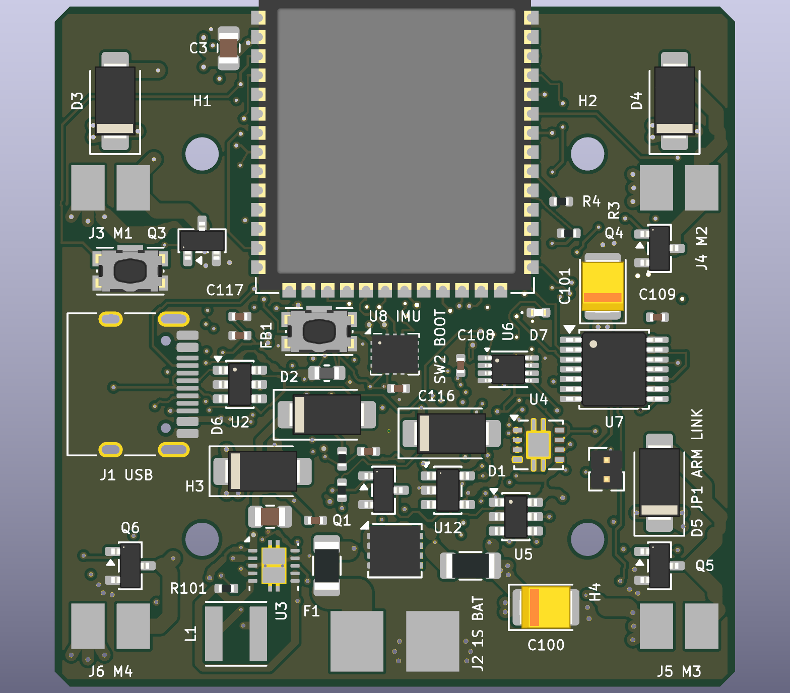

# RoveFlight S3

**RF-S3-A0 — compact ESP32-S3 flight-controller engineering prototype for a 1S brushed quadcopter.**

Hardware layout release completed 2026-11-09: **ERC 0, DRC 0, unconnected items 0, schematic/PCB parity issues 0**, with all 15 independent connectivity checks passing. [Manufacturing package](fabrication/) and [validation evidence](docs/Manufacturing_Readiness.md) are included. Via-in-pad filling/capping and fabricator DFM are required; physical qualification remains open.

A real native KiCad design with ESP32-S3-WROOM-1-N8R2, four independent brushed-motor MOSFET stages, a hardware arming latch and watchdog, BMI270 SPI IMU, BMP390 SPI barometer, battery voltage/current monitoring, downward VL53L1X, IR receiver, USB-C and receiver/optical-flow/debug expansion.

Open **RoveFlight_S3.kicad_pro** in KiCad 10. The root schematic links the functional sheets. The PCB is 45 x 45 mm, six layers, nominal 1.0-mm thickness, two-sided assembly, with 25.5-mm-square M2 mounting and an antenna overhang. The assembled antenna extends 6.75 mm beyond the forward edge. No flight-ready, fabricated-board, RF, thermal or EMC qualification is claimed.

## Electrical limits

- Protected 1S LiPo, 3.1–4.2 V. No onboard charger or cell-protection IC.
- Brushed motors only. Proposed envelope: 1 A continuous per motor, 4 A aggregate, 2 A single-channel stall for at most 100 ms, subject to actual motor/propeller and thermal qualification.
- All external signals are 3.3 V. Receiver supply/interface compatibility must be checked; no 5-V UART tolerance or SBUS inverter is provided.
- Remove JP1 to disconnect motor enable physically. USB insertion clears the arming latch. Every detected fault requires a fresh arming command; see the exact reset caveat in the safety document.
- Local attitude stabilization, failsafes, calibration, PID, mixing, telemetry, configuration, OTA and logging require firmware. The supplied bring-up skeleton only holds motors disabled and blinks the status LED.

## Engineering documentation

- [Motor numbering, calculations and interlock](docs/Motors_and_Safety.md)
- [Battery and power architecture](docs/Power_Architecture.md)
- [GPIO allocation](docs/GPIO_Allocation.md)
- [Sensor orientation and mechanics](docs/Sensors_and_Mechanics.md)
- [Recommended firmware architecture](docs/Firmware_Architecture.md)
- [Bring-up and qualification procedure](docs/Bringup_and_Validation.md)
- [Manufacturing readiness](docs/Manufacturing_Readiness.md)

BOM.csv and BOM_Grouped.csv include part numbers and footprint assignments. GPIO_Allocation.csv, Connector_Pinouts.csv and Placement.csv provide machine-readable implementation references. Manufacturer sources are recorded in datasheets/sources.json. Manufacturer catalogue listing was checked for the N8R2 variant; no distributor stock reservation or guaranteed BOM availability is claimed.

The N8R2 variant provides 8-MB Quad SPI flash and 2-MB Quad PSRAM in an 18 x 25.5 x 3.1-mm module. N8 without PSRAM was considered but leaves less buffering for logs/telemetry; N8R8 adds memory and a different memory configuration without a need in this initial design. Neither is an automatic assembly substitution. The antenna carrier-board keepout follows the official module footprint and Espressif hardware guidelines; frame, battery and wiring clearance still need RF validation.

## Construction and verification

To check and export the current design without rebuilding its placement or routing, run `python scripts/release.py` in the configured Python environment. It gates manufacturing exports on ERC, DRC, parity and connectivity checks. Verify the resulting package from this directory with `sha256sum -c fabrication/SHA256SUMS`.

Scripts require KiCad 10 system Python bindings and requirements.txt. The project was initialized and the controller instantiated through the connected KiCad MCP server; native Python construction expands the complete hierarchical schematic and board using installed KiCad libraries and an explicit pin-to-net manifest. MCP/CLI ERC and DRC provide independent validation.

The construction sequence is build_design.py -> KiCad XML netlist export -> layout.py -> prepare_routing.py -> assisted Specctra routing -> import_routing.py -> any documented repairs -> silkscreen.py -> audit_design.py and final ERC/DRC/export. **build_design.py rebuilds the schematic; layout.py clears routing. Work on a copy when experimenting.** These are engineering construction scripts, not a flight-qualified unattended release pipeline.

Original project assets are licensed under CERN-OHL-P-2.0; see LICENSE. KiCad library-derived content retains its upstream licence and exception, recorded in libraries/README.md and libraries/KiCad-LICENSE.md.

[Bottom assembly preview](previews/PCB_bottom.png). Renders show assigned library models; missing connector/sensor models are represented by their board land patterns.
