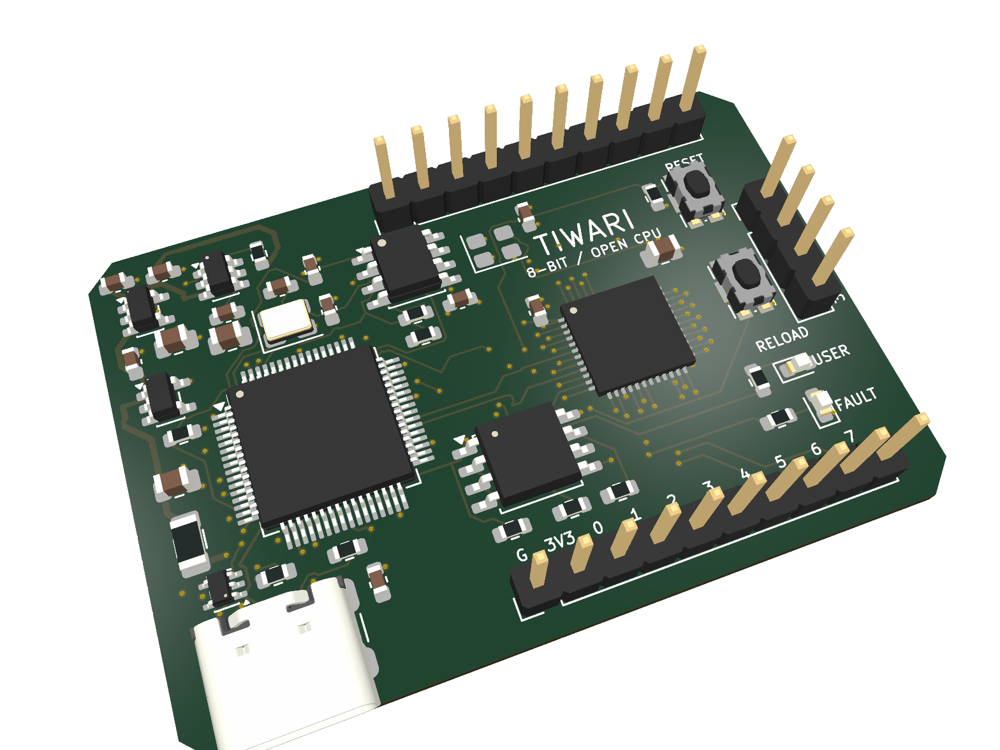

# TIWARI — your CPU, your board

An original **8-bit processor development board** with reprogrammable hardware,
USB-C programming, a USB serial console, 16 digital GPIO, two hardware PWM
outputs, and a millisecond timer. The board measures **50 × 35 mm** and uses a
four-layer PCB with a chamfered outline.

**Engineering prototype:** the processor is simulated and the PCB files are
checked by software. No board has been manufactured or tested on a bench.
See [verification](docs/Verification.md) before ordering a prototype.

TIWARI is for learning how a processor works and building small digital control
projects. The CPU lives inside a Lattice iCE40UP5K FPGA: changing Verilog changes
its hardware. An FT2232H provides USB programming and a separate serial channel.
It is an original instruction set, not an AVR processor or an Arduino clone.

| Feature | TIWARI TW8-A0 |
| --- | --- |
| Processor | Original TIWARI-8, 36 MHz, 8-bit A/B registers and arithmetic |
| Program space | 4,096 × 16-bit instructions (8 KiB), initialized in FPGA image |
| Data memory | 256 bytes, separate from program memory |
| Expansion | 16 digital GPIO and 2 dedicated PWM pins, 3.3 V only |
| USB | USB-C, FT2232H channel A programming / channel B UART |
| Serial | 115200 baud, 8 data bits, no parity, 1 stop bit |
| Timer | 16-bit milliseconds with coherent snapshot |
| Physical | 50 × 35 mm, 4 copper layers, 1.0 mm nominal thickness |
| Firmware tools | Python assembler and open-source FPGA toolchain |



## Start here

1. [Beginner guide](docs/Getting_Started.md): understand the board, run tests,
   build a program, and program an assembled prototype.
2. [Instruction set](docs/Architecture.md) and [peripheral registers](docs/Peripherals.md).
3. [KiCad project](hardware/TIWARI.kicad_pro), [bill of materials](hardware/BOM.csv),
   [assembly and fabrication notes](docs/Hardware.md).
4. [Verification evidence](docs/Verification.md) and [hardware bring-up](docs/Bringup.md).

On a supported Linux machine with the dependencies installed:

```sh
make test sim
make synth                         # default: built-in LED blink
make flash PROGRAM=examples/serial_echo.asm
```

`make flash` writes the external configuration flash over USB. It does not
program one-time FPGA NVCM. The assembled board is required for that command.
The examples include blink, digital input mirroring, PWM, and serial echo.

## What makes TIWARI different

You can inspect and change the whole processor, rather than just its software.
PWM, GPIO synchronization, UART, and the timer run in parallel hardware. The
board has a separate CPU reset and FPGA reconfiguration button, built-in fault
indication, and rear service access to configuration signals.

The small PCB is about 52% smaller in area than the classic 68.6 × 53.4 mm Uno R3.
A higher clock is not a blanket application-speed comparison: instructions,
compiler availability, peripheral behavior, and workload matter. TIWARI does
not run Arduino sketches and has no C compiler, analog ADC, interrupts, or
Arduino shield compatibility in this revision. Its advantage is hardware you
can change; it does not replace the mature Arduino library ecosystem.

## Open source

Original hardware: CERN-OHL-P-2.0. Verilog, tools, tests, and examples: MIT.
Documentation: CC-BY-4.0. The KiCad-derived reviewed FPGA symbol retains its
upstream license and attribution. See [LICENSE](LICENSE) and
[library provenance](hardware/libraries/README.md).

Contributions are welcome through issues and pull requests. Please report
which PCB revision, program image, and tool versions you tested; distinguish
simulation results from measurements on a physical board.
