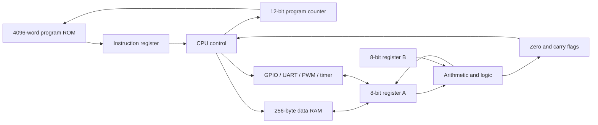

# TIWARI-8 architecture

The CPU has an 8-bit accumulator A, an 8-bit operand register B, a 12-bit word
program counter, Z (zero) and C (carry/no borrow). Reset sets A/B/PC/C to zero,
Z to one, and clears halt/fault. Arithmetic is unsigned modulo 256. There is no
stack, interrupt controller, or instruction-set compatibility with another CPU.

Every instruction occupies one 16-bit word. Bits 15:12 select the primary
operation. Branches use bits 11:0 as a word address; other operations require
bits 11:8 to be zero. Their low byte is an immediate, data address, port address,
or SYS sub-operation. Unused operand bytes are ignored by hardware and emitted
as zero by the assembler. Invalid encodings halt with fault without a store.

| Opcode | Assembly | Effect | Flags |
| --- | --- | --- | --- |
| 0000 | NOP | No operation | preserved |
| 0001 | HLT | Stop until CPU reset | preserved |
| 0002 | SHL | A = A << 1; C = old bit 7 | Z,C |
| 0003 | SHR | A = A >> 1; C = old bit 0 | Z,C |
| 0004 | MOVAB | A = B | Z |
| 0005 | MOVBA | B = A | preserved |
| 0006 | NOT | A = bitwise inverse of A | Z |
| 1n | LDI n | A = immediate byte | Z |
| 2n | LDB n | B = immediate byte | preserved |
| 3a | LDA a | A = data RAM[a] | Z |
| 4a | STA a | data RAM[a] = A | preserved |
| 5000 | ADD | A = A + B | Z,C |
| 6000 | SUB | A = A - B | Z,C |
| 7000 | AND | A = A AND B | Z |
| 8000 | OR | A = A OR B | Z |
| 9000 | XOR | A = A XOR B | Z |
| Aaaa | JMP a | PC = word address | preserved |
| Baaa | JZ a | Jump if Z = 1 | preserved |
| Caaa | JC a | Jump if C = 1 | preserved |
| Dp | IN p | A = peripheral[p] | Z |
| Ep | OUT p | peripheral[p] = A | preserved |
| Faaa | JNZ a | Jump if Z = 0 | preserved |

For byte operands the table's compact notation means, for example, `LDI 0xAB`
is word `0x10AB`, `STA 0x10` is `0x4010`, and `OUT 0x40` is `0xE040`.
ADD sets C on unsigned overflow. SUB sets C when old A >= B (no borrow).
Only operations explicitly listing C change it. MOVAB/MOVBA names are literal
assignment destination/source in this table; consult the effect column.

Program memory has 4,096 words and PC wraps modulo 4096. Data RAM is 256 bytes
and is uninitialized after configuration: store a value before reading it.
CPU reset preserves RAM and reloads execution from word zero. Programs are
initialized in the FPGA bitstream and persist in external configuration flash;
there is no separate runtime loader in this revision.

The synchronous program RAM prefetches the following instruction during EXEC,
including a taken branch target, and FETCH latches the instruction register.
Most control, immediate, and output instructions take two clocks. Arithmetic,
logic, shifts, MOVAB, LDA, and IN take three clocks through a result/read phase.
A hardware timer, PWM and UART continue after HLT. GPIO input values pass through
two synchronization registers; an asynchronous multi-bit bus is not an atomic
capture protocol. The CPU's enable input pauses internal phases, not peripherals.

The assembler supports labels, `.equ NAME value`, decimal/hex/binary literals,
and semicolon comments. Branch labels are word addresses. It validates operand
ranges and program capacity and pads unused program words with HLT.
